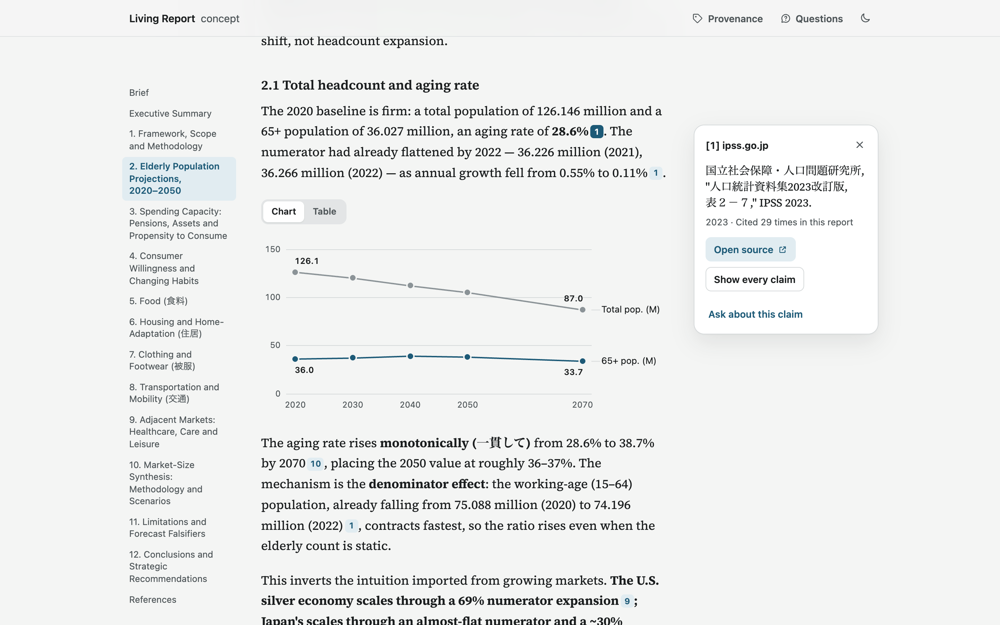

# Lunon Living Report

A reading layer for Lunon Deep Research reports: the answer first, and every figure one action away from where it came from.

**Live:** [uzookafor.com/lunon-living-report](https://uzookafor.com/lunon-living-report/)

> Unofficial concept by Uzo Okafor. Not affiliated with Lunon. Report text from Lunon Deep Research (MIT), unmodified.



## Why this exists

Lunon Deep Research writes strong reports, but its raw output leaves the reader to do the checking. Report 51 cites 61 sources through 209 inline links, each showing the full source string in the middle of a sentence, across about 10,900 words and 18 tables. Figures from outside sources and figures from the report's own model look the same.

**One typed report model drives every surface: the Brief, the Reader, the source cards, the Sources index and the questions.** The Living Report is that answer to "are the client portal and the reports one system?", shown rather than told.

## What it does

- **Brief:** the report's own answer, its 2050 range, the verdict by category and the three falsifiers, readable in under two minutes. The evidence line counts sources and cited, modeled and unattributed figures.
- **Reader:** the full report, verbatim, with each run of citation links collapsed into one small numbered marker.
- **Source cards:** a marker opens its sources (label as written, year, how often it's cited, the exact link). On desktop the card opens in the margin like a sidenote and the text never moves; on tablets it's a popover, and on phones a sheet you can drag away.
- **Trace:** "Show every claim" tints every sentence and table row that cites a source and steps through them. The trace lives in the URL, so it can be shared.
- **Provenance:** a toggle labels each figure Cited, Modeled or Not attributed. The labels come from a published parsing rule and say where a figure points, never whether the source supports it.
- **Charts:** the four numeric series tables as charts with direct labels, each with its table one tap away.
- **Questions:** pin a question to any sentence or table row, then edit, delete (with undo), copy or download them as Markdown for the engagement team. Saved in the browser when it allows.
- **Sources index:** every source, grouped by domain, most cited first.

## How it works

At build time, `parseReport()` reads `content/report-51.md` and returns a typed `Report`: sections, blocks, sentences and table rows as claims, citation runs, and deduplicated sources. The page is a static export rendered from that model. Client components only add interaction state; highlights are CSS rules, so tracing or labelling never re-renders the text.

### Parsing rules

- **Citation:** a markdown link with an http(s) URL. Links with no text between them form one cluster, shown as one marker.
- **Source:** links are the same source when their URLs match after lowercasing the host and dropping the fragment. Sources are numbered by first appearance.
- **Domain:** the host without a leading `www.` (or `www8.`).
- **Year:** the first four-digit year from 1900 to 2026 in the label that isn't part of a range. A later year is a forecast horizon, not a publication date. No year is better than a wrong one.
- **Claim:** one sentence, split with `Intl.Segmenter` after citations are removed. A citation cluster belongs to the sentence it follows. The parser rejoins sentences the segmenter splits at "vs." before a number. Each table row is one claim.
- **Provenance:** only claims that contain a figure are labelled.
  - **Modeled** if the claim, its table's header, or the paragraph right before or after its table contains "model output", "internal model", "modeled", "(model" or "the model".
  - **Cited** otherwise, if the claim has a citation.
  - **Not attributed** if it has neither.
  - Modeled wins over cited, because a modeled figure often cites its inputs. Known misses, kept rather than patched one phrase at a time: "±15% model uncertainty" (6.1) and the "Internal scenario" rows in 7.3 and 8.3.
- **Charts:** a table is charted when it's a numeric series with years across the header or down the first column. A series is charted only if every cell reads as a number once `~`, `¥`, `tn`, `%` and `+` are stripped. A bold total row makes the other rows its parts, drawn as small multiples. Percentage columns aren't drawn on an amounts axis; next to amounts they become labels. A "Scenario" table with one numeric column becomes a range bar.
- **Timeline:** the report's one mermaid `timeline` block is read into periods and events, without a Mermaid dependency.
- **Anything else** in the markdown throws at build time, so nothing is dropped silently. A test checks that every word of the report reaches the page, in order.

## Design decisions

**Typography.** Source Serif 4 for the report: a text serif drawn for long reading, subset to the 107 characters report 51 uses so the page loads one small font. UI, tables and numbers use the system face with tabular figures, which feels native on each platform and sets Japanese UI text in the platform's own Japanese font. Japanese in the report falls back to Hiragino Mincho, Yu Mincho or Noto Serif CJK, and every Japanese run is marked `lang="ja"`.

**Color.** Silver paper and graphite ink, a nod to the subject, with one accent (ai-iro, a Japanese indigo) kept for things you can act on. Charts use the accent for the series they're about and a gray for context. Every pair passes WCAG AA in both themes.

**Provenance.** Off by default, so the read stays calm; the Brief always shows the totals. Each label is a word with its own quiet style (a tint, a dotted outline, a dashed outline), never color alone.

**Motion.** Only where it explains a change, and never on reading text or on steps taken from the keyboard. Cards scale from their marker in 160ms on a strong ease-out and close faster. The trace tint fades in over 180ms. The phone sheet uses iOS's drawer curve at 300ms; its drag tracks the finger 1:1, can catch the sheet mid-slide, and dismisses on a long drag or a quick flick. Reduced motion makes all of it instant.

## Accessibility

- Landmarks, a skip link, and heading levels that match the report.
- Every control works from the keyboard with a visible focus ring. Cards keep keyboard focus while open and give it back to their marker on Escape or Close.
- Markers are named by their sources ("3 sources: [5] vantainsights.com and 2 more"), starting with their visible text.
- A polite live region announces traces, saved questions and copies.
- Targets are at least 24×24px; markers keep a small chip with a 24px hit area.
- Contrast is AA in both themes, and charts have a text summary and a table view.
- axe reports no violations in any state the suite opens, in Chrome, Safari (WebKit) and Firefox.

## Tech stack

- Next.js 16 (App Router, static export), React 19, TypeScript in strict mode
- Tailwind CSS 4
- Radix Popover and Dialog
- unified, remark-parse and remark-gfm for parsing
- Node's test runner for unit tests; Playwright and axe-core for the browser suite; Prettier with Google's gts settings

## Running it locally

Needs Node 22.18 or later.

```bash
npm ci
npm run dev        # localhost:3000/lunon-living-report/
npm test           # unit tests
npm run build      # static export in out/
```

Then, against the export:

```bash
npm run preview    # serves out/ under /lunon-living-report/, gzipped like GitHub Pages
npm run test:e2e   # Playwright in Chrome, WebKit and Firefox
npm run test:perf  # frame timing, on its own
```

`npm run lint` checks ESLint and Prettier; `npm run typecheck` runs `tsc`. The browser suite needs Chrome installed and `npx playwright install webkit firefox` once. To test the live site instead of the local export, set `BASE_URL=https://uzookafor.com/lunon-living-report/`.

The live page is part of the portfolio's GitHub Pages deploy, which builds this repo into `/lunon-living-report/`. A push here goes live the next time that deploy runs.

## Project structure

```
content/            report-51.md, verbatim, and its MIT notice
lib/report/         the model: types, parse, sources, provenance, tables, brief
lib/chart/          the shared scale, label spacing and chart summaries
lib/                questions (Markdown export) and Japanese runs
app/                the page, fonts and styles
components/         Brief, Reader, markers, cards, trace bar, questions,
                    sources index, charts/
tests/              the Playwright suite
scripts/            the export server and the font subsetter
QA.md               every check from the brief, and how it was tested
PRODUCT-NOTES.md    the brief and every decision since
```

## Credits and license

- Code: MIT, © 2026 Uzo Okafor. See [LICENSE](LICENSE).
- Report text: [Lunon Deep Research](https://github.com/LunonAI/lunon-deep-research), report 51 at commit `4c1d001`, © 2026 Lunon, MIT. Copied unmodified; see [content/NOTICE](content/NOTICE).
- Source Serif 4: © The Source Serif 4 Project Authors, SIL Open Font License 1.1. See [app/fonts/OFL.txt](app/fonts/OFL.txt).
- Unofficial concept by Uzo Okafor. Not affiliated with Lunon.
